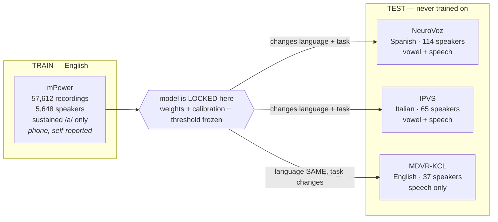
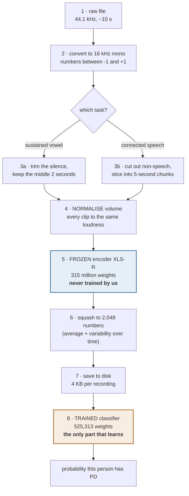
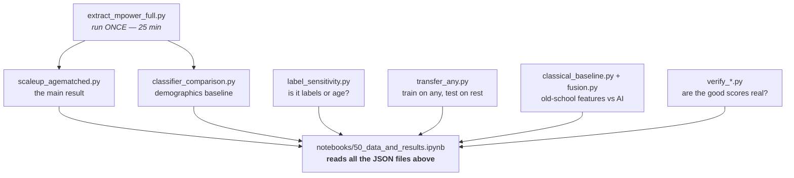

# pd-research — Voice-Based Parkinson's Disease Detection

Can you detect Parkinson's disease from a voice recording — and does a detector trained in
one language still work in another? Master's thesis by **Sudipta Ghosh** (supervisor:
Hamid Sharifzadeh).

**Short answer we found:** most of the accuracy reported in this field is not disease. It is
**age** — patients are older than controls, and voice changes with age. Control for that and
the honest signal is modest but it does travel across languages. And the **recording task**
(reading a sentence vs holding a vowel) matters more than the model does.

| Document | Read it for |
|---|---|
| **This file** | How to run everything, and what each piece means |
| [`RESEARCH_STATE.md`](RESEARCH_STATE.md) | What we know — the argument, every finding, the evidence |
| [`RESEARCH_PLAN.md`](RESEARCH_PLAN.md) | What to do next — ranked backlog |
| [`PROJECT_CONTEXT.md`](PROJECT_CONTEXT.md) | The proposal, methodology, full decisions log |
| [`HANDOFF.md`](HANDOFF.md) | Operational state for picking the work back up |

---

## 1. The big picture

We train on one dataset and test on three others **without letting the model learn anything
from them**. That is the whole point — it is how you find out whether a detector actually
generalises or has just memorised one dataset.



MDVR-KCL is the useful control: it is also English, so whatever performance we lose there is
**not** a language problem — it is the task and the microphone.

## 2. What happens to one recording

Every recording walks this path. Only the last box ever learns anything.



**The two words that confuse everyone:**

- **FROZEN** = the big encoder's weights are *never* changed by us. Ever. It is a fixed
  measuring instrument: same audio in, same 2,048 numbers out. It was trained by Meta on
  436,000 hours of speech in 128 languages that had **no disease labels at all**.
- **LOCKED** = the small classifier *does* learn — then we freeze it, along with the
  calibration and the decision threshold, **before** touching any test data. That stops us
  accidentally tuning on the answer.

So: *frozen = never learns. locked = learned already, now sealed.*

**Where the PD/healthy label enters:** only at box 8. The encoder never sees a diagnosis.

## 3. The experiments, and the order to run them



The notebook does **no experiments**. It reads the result files the scripts wrote. If a
result file is missing it tells you which script to run.

**The notebook is a normal file you edit directly** — open it in Jupyter or VS Code and
change anything. There is no generator; nothing regenerates it.

**Shared cohort logic lives in one place.** `src/pdvoice/cohort.py` holds the single
implementation of loading mPower, capping recordings per speaker, age-matching and
subject-level aggregation. Every script imports it. It used to be copy-pasted into four
scripts plus the notebook, and the copies drifted — two runs produced age-matched groups
with different mean ages purely because rows arrived in a different order.

---

## 4. Setup

**There is no conda here.** This box uses a plain Python virtual environment.

```bash
cd crosslingual-pd-voice
.venv\Scripts\python.exe -c "import torch, pdvoice; print(torch.cuda.is_available())"
```

If that prints `True`, you are ready. If you are rebuilding from scratch:

```bash
python -m venv .venv
.venv\Scripts\pip install -r env\requirements-gpu.txt
.venv\Scripts\pip install -e .
```

**Do not upgrade these — things break:**

| Package | Pin | Why |
|---|---|---|
| `torch` / `torchaudio` | `2.5.1+cu121` | must match each other exactly |
| `transformers` | `4.46.3` | 5.x refuses to load our `.bin` encoder weights |
| `numpy` | `<2.0` | downstream compatibility |

Set `HF_HUB_DISABLE_SYMLINKS_WARNING=1` before running anything, to silence a Windows warning.

**Running any script:**

```bash
.venv\Scripts\python.exe -u scripts\<name>.py [options]
```

---

## 5. What every script does — in plain language

### Start here (run in this order)

| Script | What it actually does | Time |
|---|---|---|
| `extract_mpower_full.py` | Listens to all 55,480 mPower recordings once and saves the encoder's 2,048 numbers for each. **Everything else reads this file** — run it first. | ~25 min |
| `scaleup_agematched.py` | **The main result.** Builds an age-matched group, trains, tests on all three other languages. Repeats with 5 different random draws so you get error bars, not a single lucky number. | ~10 min |
| `classifier_comparison.py` | Asks two questions: does it matter which classifier we use, and **how well does AGE ALONE do with no audio at all?** (Answer: alarmingly well.) | ~15 min |

### Understanding the data

| Script | What it actually does |
|---|---|
| `audits/data_inventory.py` | Opens every audio file and reports what is really in it — sample rate, bit depth, mono/stereo, duration. Catches datasets that disagree with their own documentation. |
| `audits/pipeline_trace.py` | Walks one recording through all 8 steps above and prints the exact size and loudness at each stage. Good for the methods chapter. |
| `audits/voice_fundamentals_figs.py` | Draws waveform / spectrum / spectrogram / mel pictures. ⚠️ **One random recording per picture** — these illustrate what a spectrogram *is*, they do **not** prove any PD/healthy difference. |
| `audits/group_spectra.py` | The honest version of the above: averages over 150 speakers per group. Shows the age confound in the raw sound, before any AI is involved. |
| `audits/silence_audit.py` | Finds recordings that are too quiet or empty. |
| `audits/amplitude_vs_harmonics.py` | Tests the supervisor's objection: *is a quiet recording actually a bad recording?* Answer: no. Turn the volume down 60 dB and back up, and every voice measurement is identical. So **never throw away audio for being quiet** — check whether there is a *voice* in it instead. |

### The main experiments

| Script | What it actually does |
|---|---|
| `label_sensitivity.py` | The key diagnosis. Asks: is the problem that mPower's labels are self-reported, or that the patients are older? Tests both. **Answer: it's the age.** |
| `agematched_eval.py` | The original single-run version of `scaleup_agematched.py`. ⚠️ **Superseded** — use the scale-up. |
| `layer1_mpower.py` | Compares the four AI encoders and different internal layers of them. |
| `layer2_transfer.py` | Trains on mPower, applies the locked model to the other languages. Also tries a cheap trick to fix the language gap (it doesn't work — that's a real result). |
| `transfer_any.py` | Generalised version: train on *any* dataset and task, test on all the others. Produces the transfer matrices. |
| `classical_baseline.py` | Old-school approach: 17 hand-designed voice measurements (jitter, shimmer, etc.) + SVM/Random Forest. The interpretable comparison. |
| `fusion.py` | Combines the AI numbers with the hand-designed ones. |

### Checking whether good scores are real

| Script | What it actually does |
|---|---|
| `verify/verify_neurovoz.py` | The Spanish speech score of 0.95 looks too good. Is it a bug? (Tests shuffled labels, age, sex, recording dates. **It's genuine.**) |
| `verify/verify_ipvs.py` | The Italian score of 1.00 looks impossible. Is it the young healthy volunteers? (**No.**) |
| `verify/verify_ipvs_batch.py` | Follow-up: Italian patients 1–10 were recorded at a different sample rate than everyone else, which the model could cheat on. Does removing them change anything? (**No — but it must still be disclosed.**) |
| `smoke_run_mpower.py` | Tiny end-to-end test to check nothing is broken. |

---

## 6. What the output files mean

```
outputs/logs/*.json          the numbers. One file per experiment. The notebook reads these.
outputs/logs/*_preds.csv     per-person predictions (probability + true label)
outputs/figures/writeup/     the pictures for the thesis
outputs/models/              the saved trained classifier
data/embeddings/*.npz        the cached 2,048 numbers per recording (big, git-ignored)
```

**Reading a results JSON** — every experiment reports the same shape:

| Field | Plain meaning | Good value |
|---|---|---|
| `auroc` | How well it separates patients from controls. 0.5 = coin flip. | higher |
| `auroc_ci` | The range the true value probably sits in. **Wide = don't trust the point estimate.** | narrow |
| `auprc` | Like AUROC but fairer when one group is much larger. | higher |
| `ece` | Calibration error. If it says "70% chance", is it right 70% of the time? | **lower** |
| `brier` | Overall probability accuracy. | **lower** |
| `sens_at_90spec` | Of all real patients, what fraction do we catch, if we accept only 10% false alarms? | higher |
| `sensitivity` | Patients correctly found (**missing these is the costly error**) | higher |
| `specificity` | Healthy people correctly cleared | higher |

---

## 7. Glossary — the words that appear everywhere

| Term | Plain meaning |
|---|---|
| **Sustained vowel** | Holding "aaaah" steady. Only tests the vocal cords. |
| **Connected speech** | Reading or talking. Tests vocal cords *plus* rhythm, articulation, pausing. **Works much better.** |
| **Embedding** | The 2,048 numbers the AI produces to describe a recording. |
| **Frozen** | The big encoder never learns anything from us. |
| **Locked** | The small classifier learned, then was sealed before testing. |
| **Subject-disjoint** | The same person is never in both training and testing. Non-negotiable. |
| **Age-matched** | We deliberately pick patients and controls of the same ages, so the model cannot cheat by detecting age. |
| **Confound** | Something that correlates with the answer but isn't the answer. Here: age. |
| **Calibration** | Whether the probabilities mean anything, not just whether the ranking is right. |
| **DCA** | Decision Curve Analysis — would using this model actually help a clinician? |
| **AUROC** | The main score. 0.5 = useless, 1.0 = perfect. |
| **Layer** | The encoder has 24 internal stages; different ones capture different things. |
| **Seed** | A random-number setting. **Running with several seeds shows how much a result wobbles** — we found some wobble a lot. |

---

## 8. Gotchas that have already cost time

- **Some cached embedding files store no row IDs.** They line up with the manifest *by position
  only*. To reproduce that order you must filter by task **then** apply quality control, in that
  order — otherwise recordings silently pair with the wrong labels and nothing errors.
- **Installing `silero-vad` can quietly replace `torchaudio` with a CPU build** and break the
  version match. Re-pin with the cu121 index URL if that happens.
- **`pandas.to_parquet` needs pyarrow**, which isn't installed — we use CSV caches.
- **Never commit `notebooks/31_layer1_results.ipynb`** — its saved output contains real
  participant identifiers.
- **`outputs/` and `pd-datasets/` are git-ignored on purpose.** The datasets carry data-use
  agreements and the derived files contain participant IDs.

## 9. Repository layout

```
src/pdvoice/          the real logic, importable as a package
  data/               one loader per dataset -> a standard table; subject-disjoint splitting
  preprocess.py       16 kHz, silence removal, chunking, quality control
  features/ssl.py     the frozen encoder
  features/classical.py  the 17 hand-designed measurements
  models/head.py      the small classifier that learns
  calibration.py      making the probabilities honest
  eval/               all the scoring
scripts/              one file per experiment (see §5)
notebooks/            50_data_and_results.ipynb is the report
outputs/              results, figures, saved models  (git-ignored)
pd-datasets/          the audio itself                (git-ignored)
```
